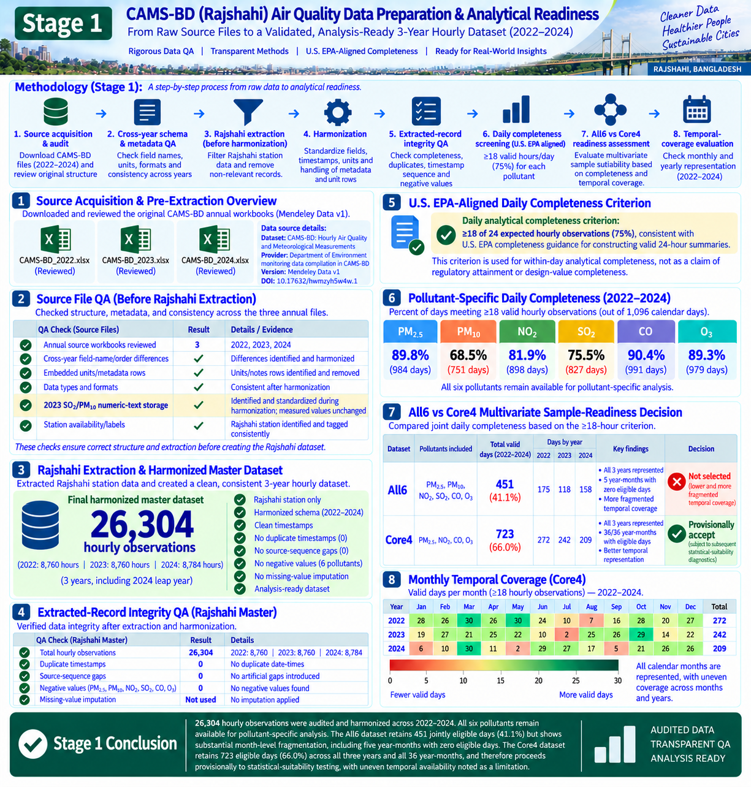
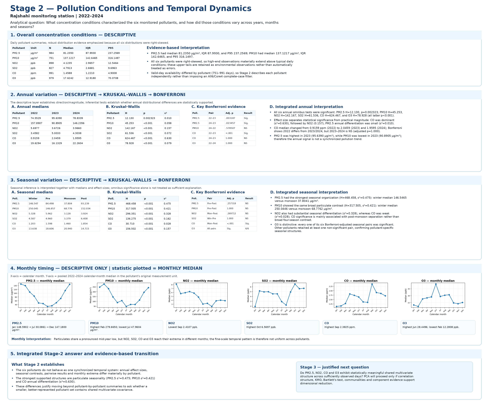
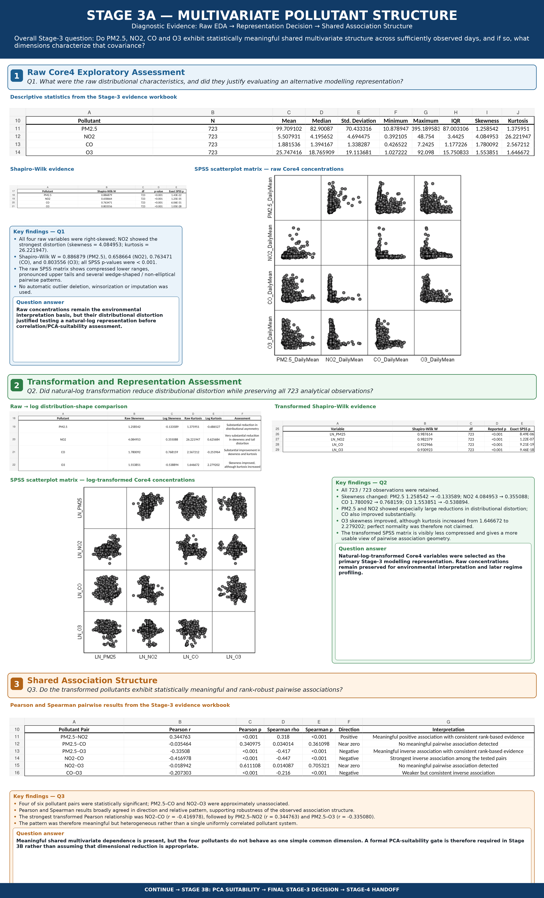
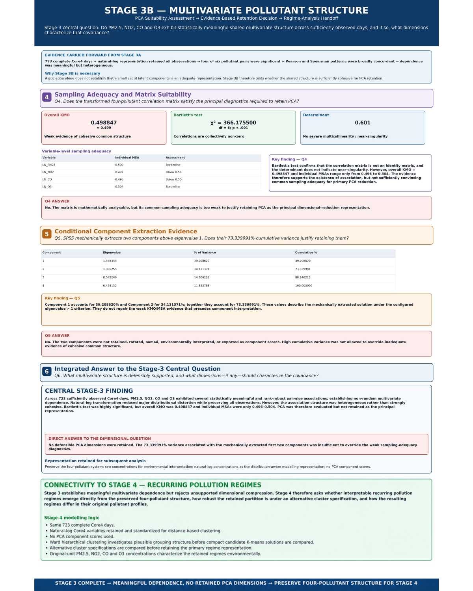
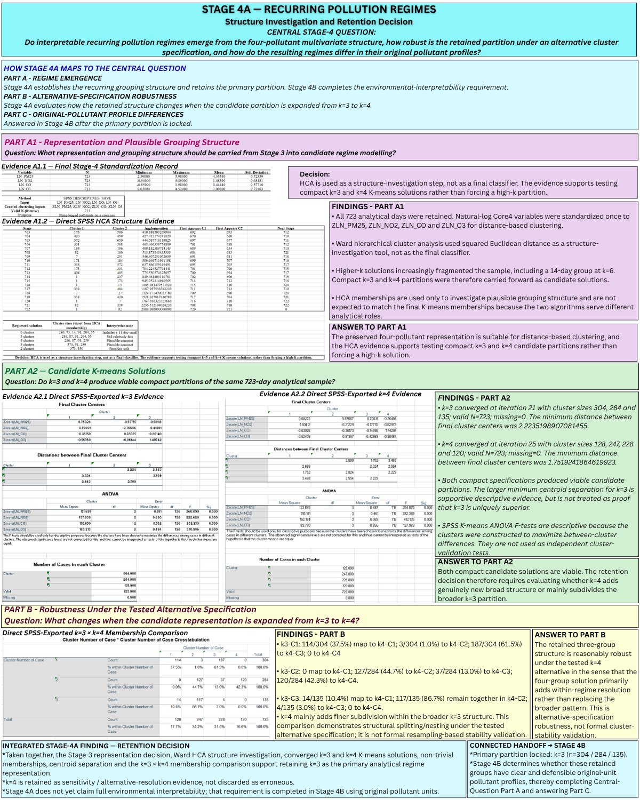
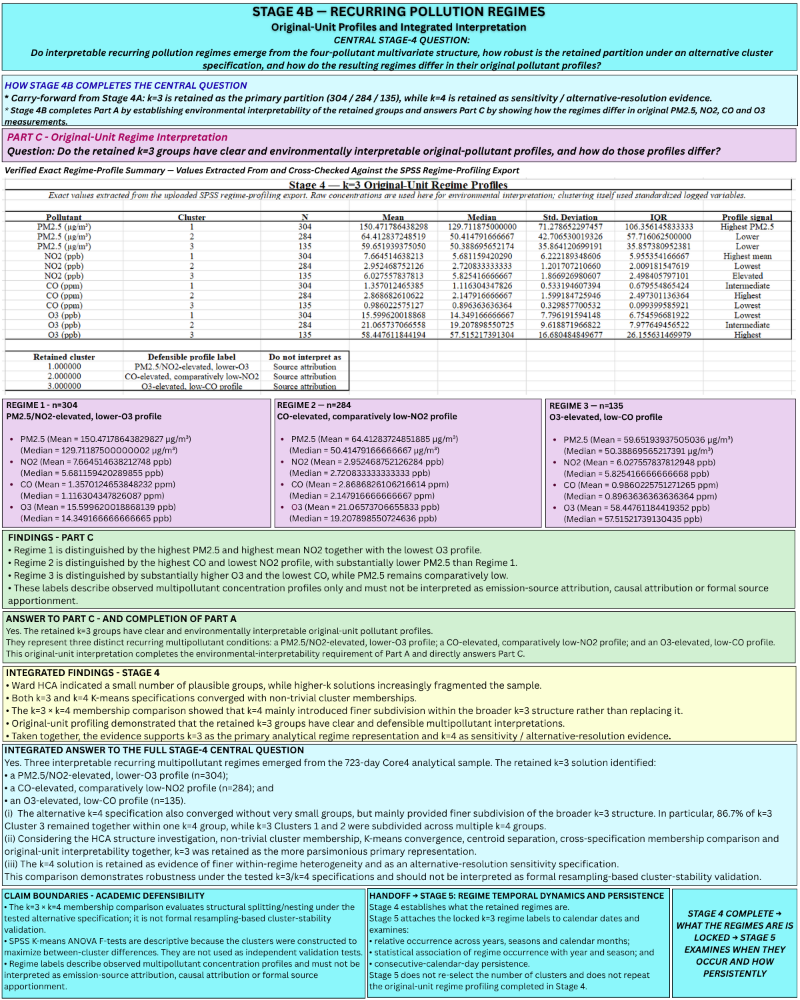
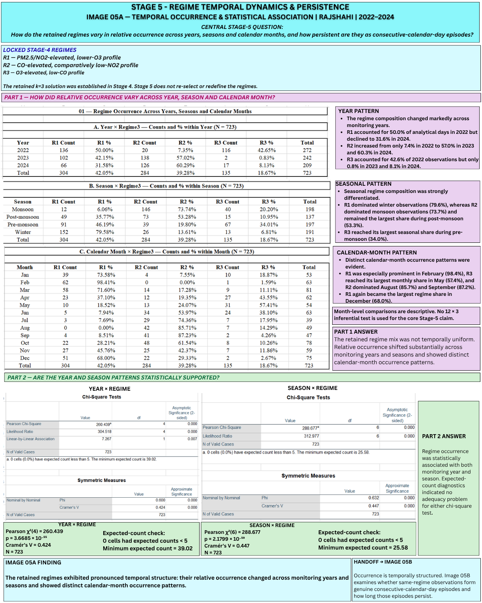
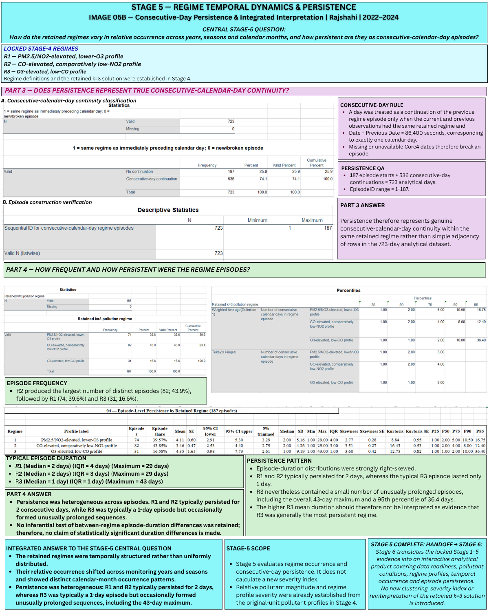

# Rajshahi Air Pollution Regime Analytics | 2022–2024

**From raw CAMS-BD monitoring data to reproducible statistical evidence, recurring pollution regimes, and interactive Excel 365 analytics.**

I developed this project to examine how air-pollutant concentrations varied over time, whether the jointly observed pollutants exhibited meaningful multivariate structure, and whether interpretable recurring pollution regimes could be identified and tracked. The work begins with three years of publicly available CAMS-BD source files, proceeds through Excel-based data preparation and SPSS statistical analyses, and concludes with staged research summaries and a separate interactive Excel 365 analytics component.

Each stage answers a specific question and establishes the evidence for the next: **data quality → pollutant conditions and timing → multivariate structure → regime identification → regime occurrence and persistence**.

**Navigation:** [Data preparation](#stage-1--source-acquisition-cleaning-and-analytical-readiness) · [Pollutant conditions](#stage-2--pollutant-conditions-and-temporal-dynamics) · [Multivariate structure](#stage-3--multivariate-pollutant-structure-and-representation-decision) · [Regimes](#stage-4--recurring-multivariate-pollution-regimes) · [Occurrence and persistence](#stage-5--temporal-occurrence-association-and-episode-persistence) · [Excel 365 reporting](#from-spss-evidence-to-interactive-excel-365-analytics) · [How to use](#how-to-explore-and-reproduce)

## Study and data at a glance

| Item | Scope |
| --- | --- |
| Location | Rajshahi monitoring station, Bangladesh |
| Period | 1 January 2022–31 December 2024, including the 2024 leap year |
| Source | Ansari and Rafi (2026), *CAMS-BD: Hourly Air Quality and Meteorological Measurements Dataset*, Mendeley Data v1, [doi:10.17632/hwmzyh5w4w.1](https://doi.org/10.17632/hwmzyh5w4w.1); original Department of Environment (DoE) station measurements |
| Initial pollutant set | PM₂.₅, PM₁₀, NO₂, SO₂, CO and O₃ (All6) |
| Final joint-analysis set | PM₂.₅, NO₂, CO and O₃ (Core4) |
| Data-preparation environment | Microsoft Excel; structured QA and daily-completeness assessment |
| Statistical analysis | IBM SPSS Statistics; descriptive, nonparametric, association, suitability, clustering and persistence analyses |
| Reporting | Stage-specific analytical result workbooks and evidence summaries, followed by Power Query–based Excel 365 dashboards |

**Data attribution.** The upstream dataset was compiled by Nafis Wadud Ansari and Abid Hasan Rafi and released under **CC BY 4.0**. The monitoring records are credited to Bangladesh’s Department of Environment; this project contains a Rajshahi-specific processed subset, derived analyses and interpretations, not a new independent monitoring campaign. See the [source dataset record](https://data.mendeley.com/datasets/hwmzyh5w4w/1).

## Research questions and analytical progression

1. Are the three annual source files sufficiently consistent and complete for defensible daily analysis?
2. How do observed concentrations and distributions differ between years, seasons and calendar months?
3. Do the jointly available Core4 pollutants have meaningful shared associations, and is dimensionality reduction justified?
4. Can recurring, environmentally interpretable multivariate regimes be identified without discarding the four-pollutant representation?
5. How does regime occurrence vary through time, and how long do uninterrupted same-regime episodes persist?

The analytical design is sequential. **Stage 2 uses pollutant-specific valid-day samples**, whereas **Stages 3–5 use the same 723-day Core4 joint sample**, not independently reselected datasets.

## End-to-end workflow

```text
CAMS-BD annual source workbooks: 2022, 2023 and 2024
                         |
                         v
      Excel extraction, harmonization and hourly QA
                  26,304 Rajshahi hours
                         |
                         v
      Daily aggregation (>=18 valid hours per pollutant)
                   1,096 calendar days
                         |
             +-----------+------------------+
             |                              |
             v                              v
  Stage 2: pollutant-specific       Joint-sample QA
  valid-day subsets (All6)          All6 = 451 days
  annual / seasonal tests           Core4 = 723 days
  monthly descriptions                    |
             |                            v
             |                     Stage 3: multivariate
             |                     diagnostics / PCA gate
             |                            |
             |                            v
             |                     Stage 4: k=3 vs k=4
             |                     clustering / profiles
             |                            |
             |                            v
             |                     Stage 5: regime timing
             |                     / calendar-day episodes
             |                            |
             +------------+---------------+
                          |
                          v
       SPSS outputs -> curated stage-result workbooks
                 and evidence-summary figures
                          |
                          v
       Power Query -> Excel Tables / formulas /
          PivotTables / PivotCharts / slicers
                          |
                          v
             Excel 365 dashboards (D01-D05)
```

## Stage 1 — Source acquisition, cleaning and analytical readiness

<details>
<summary><strong>View Stage 1 — data acquisition, QA and analytical-readiness figure</strong></summary>



</details>

**Purpose.** Build a traceable, station-specific daily record from three multi-station annual monitoring files, then determine which pollutants can be compared individually or analyzed jointly without imputation.

### Original data and Rajshahi extraction

I began with the publicly available CAMS-BD annual workbooks for **2022, 2023 and 2024**, each containing hourly measurements from multiple Bangladesh monitoring locations. I isolated the records labeled `Rajshahi` and constructed a three-year station-specific hourly file. The original annual files contributed **8,760, 8,760 and 8,784 Rajshahi observations**, respectively: **26,304 hourly records** in total.

A source-versus-processed comparison verified that **all 26,304 Rajshahi timestamps were retained**, with no duplicated timestamps and no missing entries in the original sequence. The measured values of SO₂, NO, NO₂, NOx, CO, O₃, PM₁₀ and PM₂.₅ in the processed hourly file match the source observations wherever readings are present; missing readings remain missing.

### Excel harmonization and daily preparation

The annual source files required harmonization before they could form one analytical table:

- **Station and field selection:** selected Rajshahi records, retained the relevant pollutant fields, and excluded station-specific units/metadata rows from the hourly observations.
- **Consistent column mapping:** standardized names and order across years. In particular, the 2024 source lists **PM₂.₅ before PM₁₀**, unlike the 2022–2023 layouts; the processed hourly table aligns the two fields correctly.
- **Data-type correction:** some valid-looking 2023 SO₂ and PM₁₀ readings were stored as text in the source file. Their numeric representation was standardized without changing measured values or filling missing entries.
- **Timestamp alignment:** kept the source's hourly measurement sequence and derived calendar-day keys for aggregation. The annual source blocks use a boundary-hour convention: they begin at 01:00 on 1 January and include 00:00 on the following 1 January. The daily analytical table covers the intended **1,096 calendar dates from 1 January 2022 through 31 December 2024**; it does not add a 2025 analytical day.
- **Daily summaries:** for each calendar date and each of the six target pollutants (PM₂.₅, PM₁₀, NO₂, SO₂, CO and O₃), counted available hourly measurements and computed the daily arithmetic mean **only when at least 18 valid hourly observations** were present. A daily mean remained blank if that pollutant did not satisfy the threshold. No missing-hour imputation was used.
- **Analytical attributes:** appended year, calendar month, season and separate **All6** and **Core4** completeness indicators. Seasons are defined as winter (December–February), pre-monsoon (March–May), monsoon (June–September), and post-monsoon (October–November).

The processed files preserve two distinct levels of evidence: `rajshahi_hourly_2022_2024.xlsx` contains the station-specific hourly measurements; `rajshahi_daily_2022_2024.xlsx` contains the hourly working sheet alongside `DAILY_ANALYTICAL`, with the daily means, valid-hour counts, and completeness flags. These are **processed files**, not additional original CAMS-BD downloads.

### Independent consistency and readiness checks

The project retains separate QA workbooks (`daily_completeness_assessment.xlsx` and `data_quality_summary.xlsx`) to document time coverage, pollutant availability and the decision about the primary multivariate dataset. The supplied original, processed and QA workbooks have also been cross-compared for this portfolio:

- **Source to hourly:** all 26,304 Rajshahi hourly keys and all recorded values across the eight retained pollutant fields matched the annual source files, accounting for 2024's column-order difference and numeric-text representation in 2023.
- **Hourly to daily:** valid-hour counts and retained daily means match independent reaggregation on **all 1,096 study dates** under the ≥18-hour rule.
- **Daily to QA:** the pollutant-level counts and All6/Core4 flags agree with the separate completeness workbook for all 1,096 dates.
- **QA to Core4:** the final `core4_analysis_dataset.xlsx` contains exactly the **723 passing dates**, with the same pollutant daily means and no duplicate dates.

| Pollutant | Days passing ≥18 hourly measurements | Share of 1,096 study days |
| --- | ---: | ---: |
| PM₂.₅ | 984 | 89.8% |
| PM₁₀ | 751 | 68.5% |
| NO₂ | 898 | 81.9% |
| SO₂ | 827 | 75.5% |
| CO | 991 | 90.4% |
| O₃ | 979 | 89.3% |

Each pollutant remains usable in Stage 2 on **its own eligible dates**. For joint analyses, every required pollutant must pass the completeness threshold on the **same day**:

| Joint dataset | Valid days | Share of 1,096 calendar days | Decision |
| --- | ---: | ---: | --- |
| All6: PM₂.₅, PM₁₀, NO₂, SO₂, CO, O₃ | 451 | 41.1% | Not selected as the main joint sample because coverage was sparse and uneven |
| Core4: PM₂.₅, NO₂, CO, O₃ | **723** | **66.0%** | Selected for subsequent multivariate assessment |

Core4 contains **272 eligible days in 2022, 242 in 2023 and 209 in 2024**, with representation in all 36 year-month combinations but unequal coverage across periods. This sampling limitation remains relevant when interpreting temporal patterns and regime occurrence.

**Documentation boundary.** The original step-by-step Excel cleaning log was not retained. The data-cleaning sequence above is reconstructed from, and tested against, the original files, processed workbooks and saved QA outputs; it should not be mistaken for a contemporaneous record of every Excel command or formula used during preparation.

## Stage 2 — Pollutant conditions and temporal dynamics

<details>
<summary><strong>View Stage 2 — pollutant conditions and temporal dynamics figure</strong></summary>



</details>

**Research question.** What pollutant conditions characterized the six measured pollutants, and how did those conditions vary across monitoring years, seasons and calendar months?

I used the prepared `DAILY_ANALYTICAL` dataset as the input for IBM SPSS Statistics. The SPSS setup syntax imports the daily Excel worksheet, assigns variable labels and measurement levels, and retains the six pollutant-specific valid-hour and daily-mean fields alongside the `All6_Pass75` and `Core4_Pass75` flags. Unlike the later joint analyses, Stage 2 uses the available daily measurements for **each pollutant separately**, so sample sizes differ across pollutants.

| Analysis step | Implemented SPSS procedure | Analytical purpose |
| --- | --- | --- |
| Baseline pollutant profiling | `EXAMINE` with descriptives, histograms, boxplots, normal probability plots and the 5th, 10th, 25th, 50th, 75th, 90th and 95th percentiles | Characterize distributions, typical concentrations and upper tails before group comparisons |
| Annual description | `EXAMINE ... BY Year`, grouped boxplots and selected percentiles | Compare annual distributions and medians rather than rely on pooled averages |
| Annual inference | `NPTESTS` → independent-samples Kruskal–Wallis with `COMPARE=PAIRWISE` | Test whether year-group distributions differ and examine relevant year pairs |
| Seasonal description | `EXAMINE ... BY Season`, descriptive statistics and grouped boxplots | Identify differences across winter, pre-monsoon, monsoon and post-monsoon |
| Seasonal inference | `NPTESTS` → independent-samples Kruskal–Wallis with `COMPARE=PAIRWISE` | Evaluate seasonal differences and relevant pairwise contrasts |
| Monthly description | `EXAMINE ... BY Month_Num`, descriptive statistics; calendar-month medians presented in the stage figure | Show the finer annual cycle **descriptively**, without adding a month-level inferential test |

Both inferential syntax files specify **α = 0.05**, 95% confidence level and exclusion of user-defined missing values. The descriptive procedures use available observations by pollutant. The stage evidence reports effect sizes and Bonferroni-adjusted pairwise results, which are retained in the exported results workbooks; the SPSS syntax provides the underlying test commands, while the result tables carry the reported estimates.

**Selected findings.** All six pollutants had right-skewed distributions, making medians and interquartile ranges important summaries. Annual Kruskal–Wallis results supported differences for the six pollutants, but effect magnitudes varied: CO showed the strongest reported annual contrast (**ε² ≈ 0.630**), while PM₂.₅ showed a much smaller annual effect (**ε² ≈ 0.010**). Seasonal differentiation was substantial for PM₂.₅ (**ε² ≈ 0.475**) and PM₁₀ (**ε² ≈ 0.421**), but comparatively weak for CO (**ε² ≈ 0.028**). Pairwise evidence was interpreted using the reported multiple-comparison adjustment, not omnibus significance alone. Monthly median profiles showed that pollutant peaks and troughs did not occur in a single synchronized seasonal pattern.

**Stage 2 decision.** The observed temporal behavior justified examining shared associations among the sufficiently observed Core4 pollutants, but did not establish that they could be represented by one common reduced dimension. This motivated the separate multivariate suitability assessment in Stage 3.

## Stage 3 — Multivariate pollutant structure and representation decision

<details>
<summary><strong>View Stage 3A and 3B — multivariate diagnostics and representation decision</strong></summary>

**Stage 3A — distributions, transformations and pollutant associations**



**Stage 3B — PCA suitability and the decision to retain Core4 variables**



</details>

**Purpose.** Determine whether the 723-day Core4 dataset shows meaningful shared associations and whether replacing the four variables with a smaller number of components is defensible.

1. **Raw distribution diagnostics.** In `03_core4_eda.sps`, I used `EXAMINE` for histograms, boxplots, normal-probability plots and descriptive statistics, together with a pollutant scatterplot matrix. The four raw variables were right-skewed, and normality was not supported.
2. **Transformation assessment.** `03_transformation_assessment.sps` computes `LN_PM25`, `LN_NO2`, `LN_CO` and `LN_O3` using `LN()`, then repeats distribution diagnostics and the scatterplot matrix. The transformation improved the observed shapes while retaining the 723-day dataset; perfect normality was not claimed, and raw concentrations were retained for environmental interpretation.
3. **Association structure.** `03_association_structure.sps` applies `CORRELATIONS` (Pearson) and `NONPAR CORR` (Spearman), with listwise deletion specified, to the four natural-log variables. Four of six pollutant pairs were statistically significant, but the strengths and directions were heterogeneous rather than consistent with a single strong common factor.
4. **PCA suitability gate.** `03_pca_suitability.sps` uses `FACTOR` on the log-transformed variables with correlation-matrix extraction, KMO/anti-image diagnostics, the determinant and Bartlett's test; it requests principal components without rotation. Overall **KMO = 0.498847 (≈0.499)**, while Bartlett's test was significant (**χ²(6) = 366.176, p < 0.001**). Mechanical extraction placed approximately **73.34%** of variance in the first two components, but those components were **not retained** because sampling adequacy was insufficient for the intended primary representation.

**Decision.** Preserve the four original pollutant dimensions. The later clustering input used standardized natural-log Core4 variables; it did **not** use PCA component scores.

## Stage 4 — Recurring multivariate pollution regimes

<details>
<summary><strong>View Stage 4A and 4B — clustering evidence and original-unit regime profiles</strong></summary>

**Stage 4A — clustering structure, k=3/k=4 comparison and retention**



**Stage 4B — concentration profiles and scientific interpretation**



</details>

**Purpose.** Investigate whether interpretable pollution groupings emerge from the preserved four-pollutant structure, compare a compact three-cluster partition with a four-cluster alternative, and describe the regimes in original concentration units.

- **Structure investigation:** `04_standardization.sps` uses `DESCRIPTIVES /SAVE` to produce standardized log-variable inputs. `04_hierarchical_cluster_structure.sps` then uses `CLUSTER` with Ward linkage and squared Euclidean distance to explore compact partitions, not to assign the final memberships.
- **Candidate solutions:** `04_kmeans_k3.sps` and `04_kmeans_k4.sps` apply `QUICK CLUSTER` to the four standardized log variables, request **k=3** and **k=4**, set a 50-iteration limit and convergence criterion of `0.000`, and save membership assignments. Both reported solutions converged with nontrivial cluster sizes.
- **Comparison:** centroid profiles, cluster sizes and the `CROSSTABS` command in `04_k3_k4_membership_comparison.sps` were used to examine how k=3 memberships redistribute across k=4. This is a cross-membership comparison, not independent resampling stability testing.
- **Interpretation:** `04_k3_regime_profiles.sps` uses `EXAMINE` with grouped boxplots and percentiles to profile the retained k=3 solution using **original-unit** PM₂.₅, NO₂, CO and O₃ concentrations rather than transformed-scale centers alone.

| Retained regime | Days | Share of Core4 sample | Descriptive profile |
| --- | ---: | ---: | --- |
| **R1** | 304 | 42.0% | PM₂.₅/NO₂-elevated, lower-O₃ |
| **R2** | 284 | 39.3% | CO-elevated, comparatively low-NO₂ |
| **R3** | 135 | 18.7% | O₃-elevated, low-CO |

The k=4 alternative had cluster sizes **128, 247, 228 and 120**. The cross-tabulation indicated substantial splitting and nesting within the broader retained regimes rather than a wholly different pattern. Accordingly, **k=3 was retained as the more parsimonious primary representation**, while k=4 remained an alternative-resolution sensitivity comparison.

**Interpretation boundary.** These regime names describe observed pollutant profiles, **not** proven emission sources, causal mechanisms, or formally established source apportionment. K-means ANOVA output is descriptive here; it is not independent validation of cluster significance. The k=3/k=4 comparison is not presented as formal resampling-based cluster stability validation.

## Stage 5 — Temporal occurrence, association and episode persistence

<details>
<summary><strong>View Stage 5A and 5B — occurrence, associations and episode persistence</strong></summary>

**Stage 5A — temporal occurrence and chi-square association**



**Stage 5B — consecutive-calendar-day episodes and duration summaries**



</details>

**Purpose.** Link the fixed k=3 regime assignments to calendar dates and ask *when* each regime occurs and *how long* uninterrupted same-regime conditions persist.

**Occurrence.** `05_stage5_dataset_setup.sps` maps the saved k=3 membership variable to `Regime3`. `05_regime_occurrence.sps` uses `CROSSTABS` with row percentages for year, season and calendar month. Monthly composition is descriptive only. `05_temporal_association.sps` adds Pearson chi-square, expected counts and association measures (including Cramér's V in the output) for year × regime and season × regime:

| Association | Pearson χ² | df | p-value | Cramér's V |
| --- | ---: | ---: | ---: | ---: |
| Year × regime | 260.439 | 4 | < 0.001 | 0.424 |
| Season × regime | 288.677 | 6 | < 0.001 | 0.447 |

The expected-count checks found **no cells with expected frequency below five** in either test. These results support association with time categories, not causation. Repeated daily observations may exhibit serial dependence, so conventional independence assumptions require caution.

**Persistence.** `05_regime_persistence.sps` sorts days chronologically, uses `LAG()` for the previous date and regime, and sets continuation only when the regime is unchanged and the elapsed time is exactly **86,400 seconds (one calendar day)**. Missing or unavailable dates break the run. It then builds `EpisodeID` using cumulative episode starts, calculates lengths by `AGGREGATE`, writes a separate one-record-per-episode dataset (`05_regime_episode_level.sav`), and computes episode-level duration statistics. This avoids mistakenly using day-weighted duration means. Under that rule, the 723 classified days comprise **187 episode starts** and **536 continuation days**.

| Episode metric | R1 | R2 | R3 |
| --- | ---: | ---: | ---: |
| Number of episodes | 74 | 82 | 31 |
| Median length (days) | 2 | 2 | 1 |
| Mean length (days) | 4.11 | 3.46 | 4.35 |
| Maximum length (days) | 29 | 29 | 43 |

Episode lengths were strongly right-skewed. Although R3 contains the longest single episode (43 days), its **typical episode lasted only one day**. No inferential claim is made that regime-duration distributions differ statistically, because no such between-regime inferential test was retained.

## SPSS methods and evidence map

The numerical analyses were performed in **SPSS**, not recreated by the later Excel dashboards. The original syntax and saved output files provide an inspectable record of the analytical steps:

| Stage | Main syntax and procedures | Saved evidence |
| --- | --- | --- |
| **2 — Conditions and timing** | `02_import_and_setup.sps`; `02_baseline_analysis.sps`; annual/seasonal `EXAMINE`; year/season `NPTESTS` with Kruskal–Wallis and pairwise comparisons; monthly descriptive `EXAMINE` | 7 `.sps` scripts and 6 `.spv` outputs; stage-specific pollutant/temporal result workbooks |
| **3 — Multivariate diagnostics** | `03_core4_eda.sps`; `03_transformation_assessment.sps`; `03_association_structure.sps`; `03_pca_suitability.sps` | 4 `.sps` scripts, 4 distinct `.spv` outputs and Core4 `.sav` analytical datasets |
| **4 — Regime identification** | `04_standardization.sps`; Ward `CLUSTER`; k=3/k=4 `QUICK CLUSTER`; membership `CROSSTABS`; original-unit profile `EXAMINE` | 6 `.sps` scripts, 6 `.spv` outputs and `04_regime_analysis_working.sav` |
| **5 — Timing and persistence** | `05_stage5_dataset_setup.sps`; occurrence `CROSSTABS`; chi-square association `CROSSTABS`; calendar-day `LAG`, cumulative episode IDs and `AGGREGATE` in `05_regime_persistence.sps` | 4 `.sps` scripts, 5 `.spv` outputs, the Stage 5 working `.sav` and episode-level `.sav` |

An additional Stage 5 output, `05_regime_episode_persistence.spv`, documents the episode-level descriptive analysis; it does **not** imply a separate missing syntax file, because that analysis is included in `05_regime_persistence.sps`. The 2022–2024 analysis is built on saved data stages, so executing a selected script in isolation is not necessarily sufficient: the prerequisite dataset and generated variables must already exist.

## From SPSS evidence to interactive Excel 365 analytics

The stage-level statistics and conclusions were developed upstream, in the data-preparation and SPSS workflows. I then consolidated the relevant **SPSS-derived results into separate, domain-specific Excel workbooks**. Those results became the source inputs to a separate Excel 365 reporting layer:

1. Relative source-folder configuration in the workbook's `Setup` sheet.
2. Power Query import, selection, type checking and reshaping of stage-result workbooks.
3. Cleaned, domain-specific `Data_Dxx` worksheets and structured Excel Tables.
4. Formula-driven metrics and lookups, analytical summaries, PivotTables, PivotCharts and slicers where applicable.
5. Five dashboard views: **D01 Readiness**, **D02 Temporal**, **D03 Multivariate**, **D04 Regimes** and **D05 Dynamics**.

The Excel dashboards make the **existing findings** easier to navigate and compare; they do not rerun the SPSS tests or re-estimate the cluster solutions. For the technical implementation, workbook structure, features and refresh instructions, see the [Excel 365 Analytics component](excel_365_analytics/README.md).

## Principal conclusions

- A transparent, criterion-based readiness assessment reduced the source record to an unevenly distributed but usable **723-day Core4 analytical sample**.
- Pollutants exhibited different annual, seasonal and monthly behaviors; one common temporal pattern did not explain all six.
- Meaningful pairwise Core4 associations were present, but **PCA suitability was insufficient** to justify retaining a reduced component representation.
- The preserved four-variable structure yielded three environmentally interpretable recurring regimes; the four-cluster alternative mainly provided a finer subdivision under the comparison performed.
- Regime composition varied across years and seasons. Episodes also differed descriptively in frequency and persistence, with occasional long events embedded within generally short distributions.

## Repository structure

The stage folders retain the original SPSS syntax, saved output, result summaries and research evidence figures. Supporting data and the Excel 365 reporting component are kept separate:

```text
rajshahi-air-pollution-regime-analytics/
├── README.md                         # Main research narrative and entry point
├── 01_data_quality/                 # Readiness figure and data_quality_summary.xlsx
├── 02_pollutant_conditions/         # Stage 2 syntax, outputs, result workbooks, figure
├── 03_multivariate_structure/       # Stage 3 syntax, outputs, Core4 datasets, figures
├── 04_pollution_regimes/            # Stage 4 syntax, outputs, working data, figures
├── 05_regime_temporal_dynamics/      # Stage 5 syntax, outputs, episode data, figures
├── data/
│   ├── reference/                   # Original 2022–2024 CAMS-BD source files
│   ├── processed/                   # Rajshahi hourly and daily .xlsx; daily .sav
│   └── qa/                          # daily_completeness_assessment.xlsx
├── documentation/
│   └── data_dictionary.xlsx
└── excel_365_analytics/
    ├── README.md                     # Excel-specific methods, formulas and user guide
    ├── Rajshahi_Air_Pollution_Excel365_Analytics.xlsx
    └── source_data/                 # Six prepared analytical-result workbooks
```

**Key research files:**

| Resource | Open in | Purpose |
| --- | --- | --- |
| [`data/processed/rajshahi_hourly_2022_2024.xlsx`](data/processed/rajshahi_hourly_2022_2024.xlsx) | Excel | Harmonized Rajshahi hourly record |
| [`data/processed/rajshahi_daily_2022_2024.xlsx`](data/processed/rajshahi_daily_2022_2024.xlsx) | Excel | Daily pollutant means, valid-hour counts and eligibility flags |
| [`data/qa/daily_completeness_assessment.xlsx`](data/qa/daily_completeness_assessment.xlsx) | Excel | Pollutant-specific and joint-sample completeness checks |
| [`documentation/data_dictionary.xlsx`](documentation/data_dictionary.xlsx) | Excel | Variable definitions and data conventions |
| [`01_data_quality/data_quality_summary.xlsx`](01_data_quality/data_quality_summary.xlsx) | Excel | Analytical readiness and sample selection |
| [`02_pollutant_conditions/temporal_pollutant_results.xlsx`](02_pollutant_conditions/temporal_pollutant_results.xlsx) | Excel | SPSS-derived annual/seasonal/monthly results |
| [`03_multivariate_structure/multivariate_structure_assessment.xlsx`](03_multivariate_structure/multivariate_structure_assessment.xlsx) | Excel | Core4 transformation, association and PCA diagnostics |
| [`04_pollution_regimes/04_regime_analysis_results.xlsx`](04_pollution_regimes/04_regime_analysis_results.xlsx) | Excel | k-means candidate solutions, memberships and profiles |
| [`05_regime_temporal_dynamics/05_regime_temporal_results.xlsx`](05_regime_temporal_dynamics/05_regime_temporal_results.xlsx) | Excel | Regime occurrence, association and episodes |
| [`excel_365_analytics/README.md`](excel_365_analytics/README.md) | GitHub / browser | Dedicated interactive Excel reporting documentation |

Each numbered stage also contains its `.sps` (SPSS commands) and `.spv` (saved SPSS output) files. The `.sav` datasets store intermediate working data and, in Stage 5, a one-record-per-episode table. The eight research-summary PNGs are organized within their corresponding stage folders and can be expanded above.

## How to explore and reproduce

**To explore the findings without SPSS:** Read the five stages in order and expand the accompanying figures. The stage result workbooks contain the principal numerical evidence; the separate [Excel 365 Analytics workbook and guide](excel_365_analytics/README.md) offer interactive exploration of the already completed results. GitHub does not render Excel slicers, so download the workbook and open it in desktop **Excel 365** to use them.

**To examine or reproduce the statistical workflow:**

1. **Acquire and attribute the original data.** Use the [CAMS-BD Mendeley Data v1 record](https://doi.org/10.17632/hwmzyh5w4w.1) or the three annual files retained under `data/reference/`. The 2012–2021 historical archive is not needed for this three-year analysis.
2. **Inspect the prepared data and QA.** Review the hourly, daily and completeness files under `data/`, then compare the 1,096 daily records, ≥18-of-24 valid-hour rule, All6/Core4 flags and 723 Core4 dates. The original point-and-click Excel cleaning steps were not logged; the resulting transformations were independently checked against the sources.
3. **Run Stage 2 in SPSS.** Begin with `02_pollutant_conditions/02_import_and_setup.sps`, then the baseline, annual, seasonal and monthly scripts in that folder. Update the machine-specific `/FILE=` path and ensure the `DAILY_ANALYTICAL` worksheet is selected. Use the saved `.spv` outputs and result workbooks to cross-check results.
4. **Run Stage 3 on the Core4 sample.** Open `03_multivariate_structure/core4_analysis_dataset.sav` (or the prepared working file as appropriate) and run EDA, log-transformation, correlation and PCA-suitability syntax in their analytical order. Preserve the four pollutant variables; the reported PCA component solution was not retained.
5. **Run Stage 4 on standardized log Core4 variables.** Run standardization, Ward clustering exploration, k=3 and k=4 K-means, cross-membership comparison and original-unit regime profiles in sequence. Later commands depend on the cluster-membership variables created by earlier runs; consult the supplied `04_regime_analysis_working.sav`.
6. **Run Stage 5 with the saved k=3 memberships.** Prepare `Regime3`, generate year/season/month occurrence tables and association tests, and construct episodes by the *same regime on the immediately next calendar day* rule. The episode-level `.sav` contains 187 distinct episodes, not 723 duplicated day-level durations.
7. **Open the Excel reporting layer.** Keep the six prepared result workbooks under `excel_365_analytics/source_data/`, alongside the main Excel workbook in its parent folder. Follow the [Excel component instructions](excel_365_analytics/README.md) for recalculation, PivotTables, slicers and refresh. The dashboards visualize imported results; they do not execute the SPSS computations.

**Tools:** Microsoft Excel for source preparation, quality assessment and result-workbook assembly; IBM SPSS Statistics for statistical inference, diagnostics, clustering and persistence; Excel 365/Power Query for interactive reporting. Reproducing the SPSS stages requires compatible IBM SPSS Statistics and correct input paths.

## Interpretation and attribution

This is an observational, single-station exploratory analysis. The 723-day joint sample is not temporally uniform; descriptive patterns and nominal p-values must be interpreted in that light. The 75% within-day threshold is a completeness rule, **not** a claim of regulatory compliance. The pollutant regimes are concentration-pattern labels, **not** emission-source attribution. Neither the k=3/k=4 cross-tabulation nor the K-means ANOVA outputs constitute external cluster validation.

**Original monitoring-data source:** Ansari, Nafis Wadud; Rafi, Abid Hasan (2026). *CAMS-BD: Hourly Air Quality and Meteorological Measurements Dataset*. Mendeley Data, V1. [https://doi.org/10.17632/hwmzyh5w4w.1](https://doi.org/10.17632/hwmzyh5w4w.1). Distributed under CC BY 4.0. The original contributors and Bangladesh Department of Environment are credited for the monitoring-data compilation; station extraction, cleaning decisions, analyses and figures in this repository are subsequent project work.
